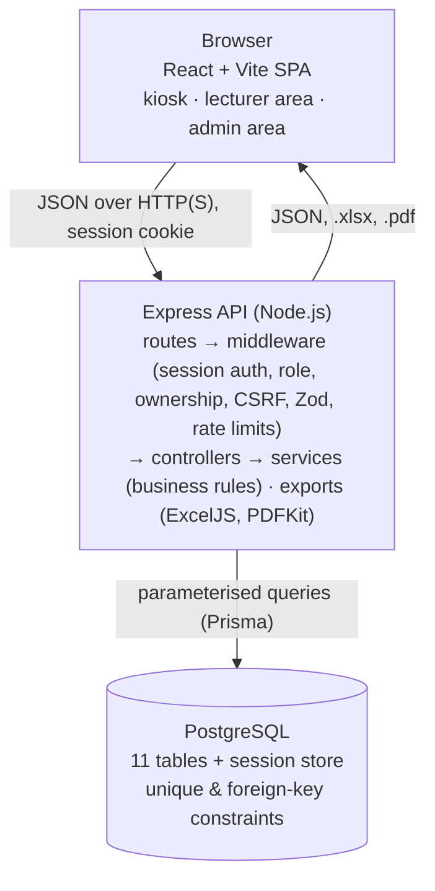
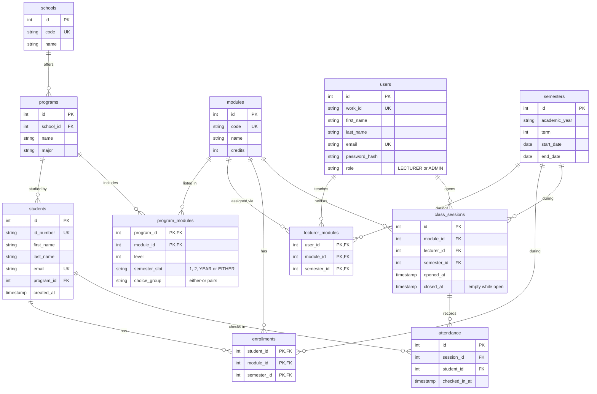

# Student Attendance Management System

A full-stack web application that replaces paper attendance sheets for the **School of Computing & Information Technology (SCIT)**. Students check in with their ID number and one tap; lecturers open and close attendance sessions for their own courses and export reports; administrators maintain the academic catalog taken from the SCIT diet sheets.

Built with **React + Vite**, **Node.js + Express** and **PostgreSQL** (Prisma ORM 7) - JavaScript end to end.

## Features

**Students**

- First-time registration: name, ID number, email, programme and this semester's modules (either/or pairs enforced)
- Check-in kiosk at `/`: enter ID → confirm name and programme → tap a course with an open session → confirmation, then the screen resets for the next student
- Clear messages for unknown IDs (with a link to register), no open sessions, not enrolled, already checked in, closed sessions and network errors
- Works on a shared device at the classroom door and on phones

**Lecturers**

- Two-step registration (details, then programmes and courses)
- Separate lecturer login (`/lecturer/login`)
- Dashboard of their current-semester courses with **Open session / Close session** - sessions never close automatically - and live check-in counts
- Attendance view filtered by course and date, exported to **Excel (.xlsx)** or **PDF**, generated on the server

**Administrators**

- Separate administrator login (`/admin/login`); no public admin registration
- Manage schools, programmes, modules, programme-module assignments (level, semester slot, either/or group), semesters, students and enrollments, lecturer accounts and course assignments, and other administrators

**Catalog** - all 22 diet sheets in `docs/SCIT-DIET-SHEETS` are transcribed: **12 programmes, 183 modules** (shared modules stored once), year-long modules such as PRJ4020, and either/or pairs such as ENS3001 / MEE2003.

## Technology stack

| Layer                 | Technology                                                                |
| --------------------- | ------------------------------------------------------------------------- |
| Frontend              | React 19, Vite 8, React Router 8, Fetch API, plain CSS                    |
| Backend               | Node.js 24 LTS, Express 5 (traditional long-running server)               |
| Database              | PostgreSQL 18, Prisma ORM 7 + `@prisma/adapter-pg`                        |
| Authentication        | bcrypt, express-session with PostgreSQL session store (connect-pg-simple) |
| Validation & security | Zod, helmet, CORS, CSRF tokens + origin check, express-rate-limit         |
| Reports               | ExcelJS, PDFKit                                                           |
| Testing               | Vitest, Supertest                                                         |
| Code quality          | ESLint, Prettier                                                          |

## Architecture



The React app never talks to the database. Every rule - open session, enrollment, duplicates, ownership, roles - is enforced by the Express API, and the most important ones also by PostgreSQL constraints.

## Database



Details of every table, key and constraint: [docs/DATABASE-GUIDE.md](docs/DATABASE-GUIDE.md).

## Project structure

```text
student-attendance-system/
├── client/                     React + Vite frontend
│   └── src/
│       ├── components/         student/ lecturer/ admin/ forms/ common/
│       ├── pages/              student/ lecturer/ admin/
│       ├── routes/             ProtectedRoute, LecturerProtectedRoute, AdminProtectedRoute
│       ├── context/  hooks/    auth + notification state
│       ├── services/           Fetch API client and endpoint functions
│       └── styles/             design tokens, components, layouts
├── server/                     Express backend
│   ├── src/
│   │   ├── app.js  server.js   Express app and HTTP server (graceful shutdown)
│   │   ├── routes/  controllers/  services/  middleware/  exports/  config/  utils/
│   │   └── db/                 schema.prisma, migrations/, seed.js, createAdmin.js, catalog/
│   └── tests/                  unit/ and api/ (Vitest + Supertest)
├── scripts/setup-local-db.sh   creates the PostgreSQL role and databases
├── docs/                       guides, project plan, setup guide, SCIT diet sheets
└── package.json                root scripts (dev, test, lint, build, format)
```

## Getting started

Requires Node.js 22.18+ (24 LTS recommended), npm and PostgreSQL. Full instructions: [docs/BUILD-AND-SETUP-GUIDE.md](docs/BUILD-AND-SETUP-GUIDE.md).

```bash
npm run install:all                                  # root, server and client dependencies
cp server/.env.example server/.env                   # set DATABASE_URL, TEST_DATABASE_URL, SESSION_SECRET
cp client/.env.example client/.env                   # VITE_API_URL=http://localhost:5000/api
sudo bash scripts/setup-local-db.sh                  # PostgreSQL role + dev and test databases
npm run db:deploy                                    # apply migrations
npm run db:seed                                      # SCIT catalog, semesters, development accounts
npm run dev                                          # API on :5000, web app on :5173
```

Open http://localhost:5173.

### Environment variables

| `server/.env`                                                        | Purpose                                                                |
| -------------------------------------------------------------------- | ---------------------------------------------------------------------- |
| `DATABASE_URL`                                                       | PostgreSQL connection string                                           |
| `TEST_DATABASE_URL`                                                  | Separate database for automated tests                                  |
| `SESSION_SECRET`                                                     | Long random string (`openssl rand -hex 48`)                            |
| `CLIENT_URL`                                                         | Allowed frontend origin(s) for CORS/CSRF, e.g. `http://localhost:5173` |
| `PORT`, `NODE_ENV`, `APP_TIMEZONE`, `TRUST_PROXY`, `SERVE_CLIENT`, … | See `server/.env.example`                                              |

| `client/.env`  | Purpose                                      |
| -------------- | -------------------------------------------- |
| `VITE_API_URL` | API base URL (`/api` when served by Express) |

### Development accounts (local only)

| Role          | Login                               | Password         |
| ------------- | ----------------------------------- | ---------------- |
| Administrator | `admin@example.com` or `ADMIN001`   | `Admin@12345`    |
| Lecturer      | `lecturer1@example.com` or `LEC001` | `Lecturer@12345` |
| Lecturer      | `lecturer2@example.com` or `LEC002` | `Lecturer@12345` |
| Students      | ID numbers `2600001` – `2600004`    | -                |

These come from the development seed only. Create real administrators with `npm run create-admin` (see the setup guide).

## Testing

```bash
npm test                         # all server tests (unit + API against TEST_DATABASE_URL)
npm run test:unit --prefix server
npm run test:api --prefix server
npm run lint                     # ESLint, server and client
npm run build                    # production build of the frontend
```

Current result: **175 tests passing** across registration, check-in, duplicate prevention under concurrency, lecturer ownership, exports, admin CRUD, role separation, sessions, CSRF, CORS, rate limiting and injection handling. See [docs/TESTING-GUIDE.md](docs/TESTING-GUIDE.md).

## Authentication architecture

- **Two login systems** sharing one `users` table: `/lecturer/login` → `POST /api/auth/lecturer/login` accepts only `LECTURER` accounts; `/admin/login` → `POST /api/auth/admin/login` accepts only `ADMIN` accounts. The wrong role is refused and no session is created.
- Passwords are hashed with **bcrypt**; hashes are never returned by the API.
- Sessions are stored in **PostgreSQL** and identified by an **HTTP-only** cookie (`SameSite=Lax`, `Secure` in production). The session ID is **regenerated at login**; **logout destroys** the server-side session.
- Middleware `requireAuth`, `requireRole`, `requireLecturer` and `requireAdmin` guard every protected route, reloading the user from the database on each request. Lecturer routes add **ownership** checks (course assigned to them; session opened by them).
- Identity always comes from the server-side session - never from user IDs or roles sent by the browser.
- State-changing requests need a **CSRF token** (synchronizer token in the `X-CSRF-Token` header) and an allowed `Origin`.

## Attendance integrity

Duplicate check-ins are prevented on three levels:

1. **Frontend** - the course button is disabled while a check-in is in progress.
2. **Backend** - inside one transaction the API locks the class session row (`FOR SHARE`), confirms it is open, confirms the student is enrolled for that semester and checks for an existing record.
3. **Database** - `ALTER TABLE attendance ADD CONSTRAINT unique_session_student UNIQUE (session_id, student_id)` is the final guarantee. If two identical requests arrive at the same moment, PostgreSQL accepts one and rejects the other; the API answers `409 Conflict` - "Attendance has already been recorded for this session." The test suite fires 12 simultaneous requests and verifies exactly one record is created.

Check-in times come from PostgreSQL (`DEFAULT now()`); a client-supplied timestamp is rejected. Closed sessions reject new check-ins.

## Documentation

| Document                                                       | Contents                                                                                                                       |
| -------------------------------------------------------------- | ------------------------------------------------------------------------------------------------------------------------------ |
| [docs/BUILD-AND-SETUP-GUIDE.md](docs/BUILD-AND-SETUP-GUIDE.md) | Installation, database, environment, running, authentication, testing, production build, hosting, troubleshooting, maintenance |
| [docs/API-DOCUMENTATION.md](docs/API-DOCUMENTATION.md)         | Every endpoint with request/response examples, roles and error codes                                                           |
| [docs/DATABASE-GUIDE.md](docs/DATABASE-GUIDE.md)               | Tables, keys, constraints, ERD, migrations, seed data                                                                          |
| [docs/TESTING-GUIDE.md](docs/TESTING-GUIDE.md)                 | Test tools, structure, commands, what each suite covers, manual checklist                                                      |
| [docs/OPEN-DECISIONS.md](docs/OPEN-DECISIONS.md)               | The plan's open questions and the decisions made while building                                                                |
| [docs/DIET-SHEET-IMPORT.md](docs/DIET-SHEET-IMPORT.md)         | How the SCIT diet sheets became catalog data, and every reconciliation                                                         |
| [docs/WSL-ENVIRONMENT-SETUP.md](docs/WSL-ENVIRONMENT-SETUP.md) | Development environment checked against the Ubuntu setup guide                                                                 |

## Hosting

The backend is a **traditional, continuously running Express server** - not serverless. It runs on any host that can keep a Node.js process alive (VM, dedicated server, container) with an external PostgreSQL database: build the frontend (`npm run build`), set production environment variables (`NODE_ENV=production`, `SERVE_CLIENT=true`, `TRUST_PROXY=1`, HTTPS `CLIENT_URL`), run `npm run db:deploy`, and start `npm start` under a process manager behind an HTTPS reverse proxy. Step-by-step instructions, including a systemd unit and an nginx example, are in [section J of the setup guide](docs/BUILD-AND-SETUP-GUIDE.md#j-traditional-express-hosting).
