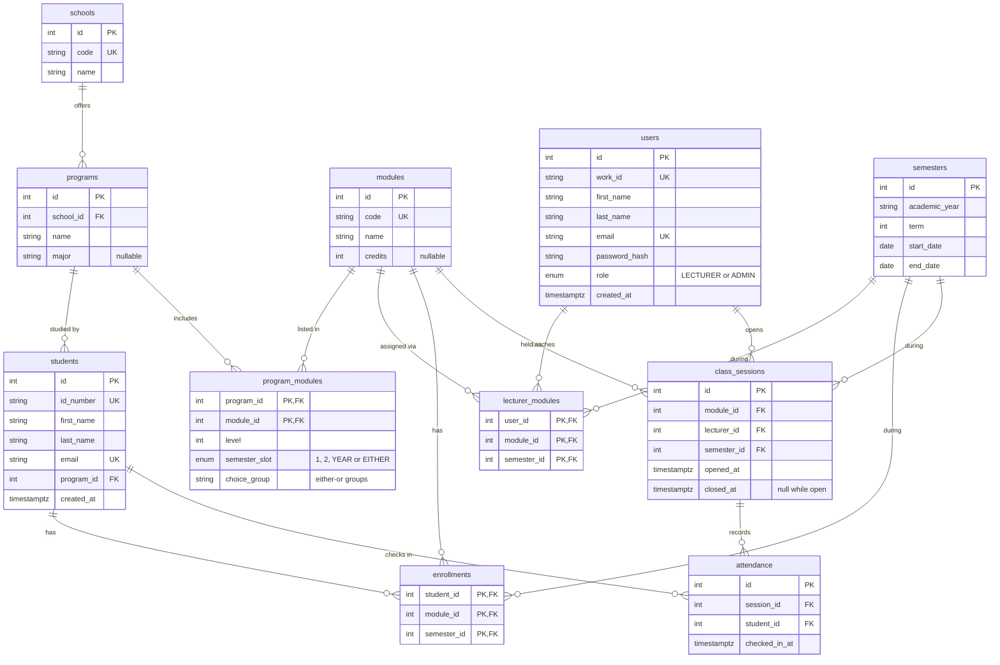

# Database Guide

The Student Attendance Management System stores everything in **PostgreSQL** (developed against PostgreSQL 18). The schema is defined with **Prisma ORM 7** in [`server/src/db/schema.prisma`](../server/src/db/schema.prisma) and applied with Prisma Migrate. Models are camelCase in JavaScript but mapped to the snake_case table and column names from the project plan, so the database matches the plan's 11-table design exactly.

- [Entity-relationship diagram](#entity-relationship-diagram)
- [Tables](#tables)
- [The attendance unique constraint](#the-attendance-unique-constraint)
- [Other constraints and indexes](#other-constraints-and-indexes)
- [Migrations](#migrations)
- [Seed data](#seed-data)
- [Catalog import](#catalog-import)
- [Inspecting and resetting the database](#inspecting-and-resetting-the-database)

## Entity-relationship diagram



Read each relationship from the "one" side to the "many" side: one class session records many attendance rows.

## Tables

All primary keys are `integer` identity columns (`SERIAL`). Timestamps are `timestamptz` and are always produced by PostgreSQL (`DEFAULT now()` / `now()`), never by the browser.

### 1. `schools`

| Column | Type         | Notes                    |
| ------ | ------------ | ------------------------ |
| `id`   | int          | Primary key              |
| `code` | varchar(20)  | **Unique** (e.g. `SCIT`) |
| `name` | varchar(150) |                          |

### 2. `programs`

| Column      | Type                   | Notes                                                                               |
| ----------- | ---------------------- | ----------------------------------------------------------------------------------- |
| `id`        | int                    | Primary key                                                                         |
| `school_id` | int                    | FK → `schools.id` (`ON DELETE RESTRICT`)                                            |
| `name`      | varchar(150)           | e.g. `BSc Computing`                                                                |
| `major`     | varchar(150), nullable | e.g. `Computer Science`; null for programmes without majors (Applied AI, Animation) |

### 3. `modules`

| Column    | Type          | Notes                                                                                                          |
| --------- | ------------- | -------------------------------------------------------------------------------------------------------------- |
| `id`      | int           | Primary key                                                                                                    |
| `code`    | varchar(20)   | **Unique** (e.g. `CIT2004`)                                                                                    |
| `name`    | varchar(200)  |                                                                                                                |
| `credits` | int, nullable | Null when a diet sheet does not list credits (some elective tables). `CHECK (credits IS NULL OR credits >= 0)` |

A module is stored **once**, even when several programmes use it (shared modules are linked through `program_modules`).

### 4. `program_modules` (programmes ⇄ modules, many-to-many)

| Column          | Type                  | Notes                                                                  |
| --------------- | --------------------- | ---------------------------------------------------------------------- |
| `program_id`    | int                   | PK part, FK → `programs.id` (`ON DELETE CASCADE`)                      |
| `module_id`     | int                   | PK part, FK → `modules.id` (`ON DELETE CASCADE`)                       |
| `level`         | int                   | Academic level/year, `CHECK (level BETWEEN 1 AND 6)`                   |
| `semester_slot` | enum `semester_slot`  | `'1'`, `'2'`, `'YEAR'`, `'EITHER'`                                     |
| `choice_group`  | varchar(60), nullable | Modules in the same programme with the same value are an either/or set |

**Primary key:** `(program_id, module_id)`.

Semester slots:

| Value    | Meaning                                                                                                                               | Offered in term 1 | Offered in term 2 |
| -------- | ------------------------------------------------------------------------------------------------------------------------------------- | ----------------- | ----------------- |
| `1`      | Semester 1 module                                                                                                                     | ✓                 |                   |
| `2`      | Semester 2 module                                                                                                                     |                   | ✓                 |
| `YEAR`   | Year-long module (e.g. `PRJ4020` Major Project)                                                                                       | ✓                 | ✓                 |
| `EITHER` | The diet sheet allows either semester (e.g. `CSP1001` "can be completed in SEM1 or SEM2", or an elective pool with no semester given) | ✓                 | ✓                 |

`EITHER` is an addition to the plan's `1 / 2 / YEAR` list, needed to represent the diet sheets faithfully; see [OPEN-DECISIONS.md](OPEN-DECISIONS.md#6-elective-and-either-semester-modules).

### 5. `semesters`

| Column          | Type       | Notes                                        |
| --------------- | ---------- | -------------------------------------------- |
| `id`            | int        | Primary key                                  |
| `academic_year` | varchar(9) | e.g. `2026/2027`, `CHECK` format `NNNN/NNNN` |
| `term`          | int        | `CHECK (term IN (1, 2))`                     |
| `start_date`    | date       |                                              |
| `end_date`      | date       | `CHECK (end_date > start_date)`              |

**Unique:** `(academic_year, term)`. The API also refuses overlapping date ranges, so "the semester containing today" is never ambiguous.

### 6. `students`

| Column                    | Type         | Notes                                                                                            |
| ------------------------- | ------------ | ------------------------------------------------------------------------------------------------ |
| `id`                      | int          | Primary key                                                                                      |
| `id_number`               | varchar(20)  | **Unique**; stored upper-case                                                                    |
| `first_name`, `last_name` | varchar(100) |                                                                                                  |
| `email`                   | varchar(254) | **Unique**; stored lower-case (`CHECK (email = lower(email))`) so uniqueness is case-insensitive |
| `program_id`              | int          | FK → `programs.id` (`ON DELETE RESTRICT`)                                                        |
| `created_at`              | timestamptz  | `DEFAULT now()`                                                                                  |

### 7. `users` (lecturers and administrators)

| Column                    | Type         | Notes                                                        |
| ------------------------- | ------------ | ------------------------------------------------------------ |
| `id`                      | int          | Primary key                                                  |
| `work_id`                 | varchar(20)  | **Unique**; stored upper-case                                |
| `first_name`, `last_name` | varchar(100) |                                                              |
| `email`                   | varchar(254) | **Unique**; lower-case                                       |
| `password_hash`           | varchar(100) | bcrypt hash - plaintext passwords are never stored           |
| `role`                    | enum `Role`  | `LECTURER` or `ADMIN` - enforced by the PostgreSQL enum type |
| `created_at`              | timestamptz  | `DEFAULT now()`                                              |

### 8. `lecturer_modules` (lecturers ⇄ modules, per semester)

| Column        | Notes                                               |
| ------------- | --------------------------------------------------- |
| `user_id`     | PK part, FK → `users.id` (`ON DELETE CASCADE`)      |
| `module_id`   | PK part, FK → `modules.id` (`ON DELETE RESTRICT`)   |
| `semester_id` | PK part, FK → `semesters.id` (`ON DELETE RESTRICT`) |

**Primary key:** `(user_id, module_id, semester_id)`. This table is what "a lecturer owns a course" means.

### 9. `enrollments` (students ⇄ modules, per semester)

| Column        | Notes                                               |
| ------------- | --------------------------------------------------- |
| `student_id`  | PK part, FK → `students.id` (`ON DELETE CASCADE`)   |
| `module_id`   | PK part, FK → `modules.id` (`ON DELETE RESTRICT`)   |
| `semester_id` | PK part, FK → `semesters.id` (`ON DELETE RESTRICT`) |

**Primary key:** `(student_id, module_id, semester_id)`.

### 10. `class_sessions`

| Column        | Type                  | Notes                                                                                                                                                                           |
| ------------- | --------------------- | ------------------------------------------------------------------------------------------------------------------------------------------------------------------------------- |
| `id`          | int                   | Primary key                                                                                                                                                                     |
| `module_id`   | int                   | FK → `modules.id`                                                                                                                                                               |
| `lecturer_id` | int                   | FK → `users.id`                                                                                                                                                                 |
| `semester_id` | int                   | FK → `semesters.id`                                                                                                                                                             |
| `opened_at`   | timestamptz           | `DEFAULT now()`                                                                                                                                                                 |
| `closed_at`   | timestamptz, nullable | **Null means the session is open.** Set to `now()` only when the lecturer closes it - sessions never close automatically. `CHECK (closed_at IS NULL OR closed_at >= opened_at)` |

### 11. `attendance`

| Column          | Type        | Notes                                           |
| --------------- | ----------- | ----------------------------------------------- |
| `id`            | int         | Primary key                                     |
| `session_id`    | int         | FK → `class_sessions.id` (`ON DELETE RESTRICT`) |
| `student_id`    | int         | FK → `students.id` (`ON DELETE RESTRICT`)       |
| `checked_in_at` | timestamptz | `DEFAULT now()` - generated by PostgreSQL       |

**Unique constraint:** `unique_session_student UNIQUE (session_id, student_id)`.

### Infrastructure table: `session`

Not part of the 11-table domain model: it stores lecturer/administrator login sessions for `express-session` (via `connect-pg-simple`) so logins survive server restarts. Columns: `sid` (PK), `sess` (JSON), `expire` (indexed). It is created by the migrations like every other table.

## The attendance unique constraint

```sql
ALTER TABLE attendance
  ADD CONSTRAINT unique_session_student UNIQUE (session_id, student_id);
```

**Why it is needed.** The API checks for an existing check-in before inserting one, but a check-then-insert is not enough on its own: if a student double-taps the button, a browser retries, or two requests arrive at the same instant, both requests can pass the "does a record exist?" check before either has inserted. Only the database can make "one row per student per session" impossible to break, because PostgreSQL checks the unique index atomically as each row is inserted.

How the layers fit together:

1. **Frontend** - the course button is disabled while a check-in is in flight.
2. **Backend** - `attendanceService.checkIn` validates the session (open, exists), the enrollment, and looks for an existing record, all inside one transaction that holds a `FOR SHARE` lock on the class session row (so a lecturer closing the session at that moment cannot race the insert).
3. **Database** - `unique_session_student` rejects any duplicate that slips past 1 and 2. The API catches the violation (Prisma error `P2002`) and returns `409 Conflict` with `"Attendance has already been recorded for this session."` - the raw SQL error is never shown.

The test suite fires 12 identical check-ins simultaneously and verifies exactly one succeeds ([`tests/api/attendance.test.js`](../server/tests/api/attendance.test.js)).

Prisma's schema language creates `@@unique` as a unique _index_; the second migration converts it into the named table constraint above (`ADD CONSTRAINT ... UNIQUE USING INDEX`).

## Other constraints and indexes

Added by hand in [`20261125000100_integrity_constraints/migration.sql`](../server/src/db/migrations/20261125000100_integrity_constraints/migration.sql) because Prisma's schema language cannot express them:

| Constraint                                                                                                                                      | Purpose                                                                                      |
| ----------------------------------------------------------------------------------------------------------------------------------------------- | -------------------------------------------------------------------------------------------- |
| `one_open_session_per_lecturer_module` - partial unique index on `class_sessions (lecturer_id, module_id, semester_id) WHERE closed_at IS NULL` | A lecturer cannot have two open sessions for the same course (stops double-click duplicates) |
| `class_sessions_closed_after_opened`                                                                                                            | `closed_at >= opened_at`                                                                     |
| `semesters_term_check`, `semesters_dates_check`, `semesters_academic_year_format`                                                               | Valid terms, date order, `2026/2027` format                                                  |
| `program_modules_level_check`                                                                                                                   | Level 1–6                                                                                    |
| `modules_credits_check`                                                                                                                         | Credits are null or ≥ 0                                                                      |
| `students_email_lowercase`, `users_email_lowercase`                                                                                             | Emails stored lower-case, so uniqueness ignores case                                         |

Prisma Migrate tolerates these hand-written additions: `prisma migrate diff` between the migrations and the schema is empty, so future `prisma migrate dev` runs will not try to drop them.

Indexes exist on every foreign key used for lookups (`programs.school_id`, `program_modules.module_id`, `lecturer_modules (module_id, semester_id)`, `enrollments (module_id, semester_id)`, `class_sessions (module_id, semester_id)`, `class_sessions.lecturer_id`, `attendance.student_id`, `students.program_id`).

### Timezones

Columns are `timestamptz`. Every database connection opened by the app sets `TimeZone=UTC` (see [`server/src/db/client.js`](../server/src/db/client.js)). This matters: Prisma's PostgreSQL adapter sends timestamps as UTC without an offset, so with a non-UTC session timezone PostgreSQL would store them shifted by the server's UTC offset. Calendar questions ("what is today?", "check-ins on 2026-11-25") are answered in `APP_TIMEZONE` (default `America/Jamaica`).

## Migrations

Migrations live in [`server/src/db/migrations/`](../server/src/db/migrations):

| Migration                              | Contents                                                                      |
| -------------------------------------- | ----------------------------------------------------------------------------- |
| `20261125000000_init`                  | Generated by Prisma from the schema: enum types, all tables, keys and indexes |
| `20261125000100_integrity_constraints` | Hand-written constraints listed above                                         |

Commands (run in `server/`):

```bash
npm run db:deploy     # apply all pending migrations (production and CI)
npm run db:migrate    # development: create + apply a new migration after editing schema.prisma
npm run db:generate   # regenerate the Prisma client (also runs on npm install)
```

To change the schema: edit `src/db/schema.prisma`, run `npm run db:migrate -- --name describe_change`, review the generated SQL, run the tests, and commit the migration folder.

## Seed data

`npm run db:seed` ([`server/src/db/seed.js`](../server/src/db/seed.js)) is safe to run repeatedly. It:

1. Imports the full SCIT catalog transcribed from the diet sheets (1 school, 12 programmes, 183 modules, 654 programme-module links).
2. Creates semesters for the previous, current and next academic year using the standard calendar (Semester 1: 1 Sep – 31 Dec, Semester 2: 1 Jan – 31 May). These are development defaults - set the official dates in the admin area.
3. Creates **development-only** accounts and sample data:

| Account                  | Login                              | Password                    |
| ------------------------ | ---------------------------------- | --------------------------- |
| Administrator            | `admin@example.com` / `ADMIN001`   | `Admin@12345`               |
| Lecturer (Morgan Ellis)  | `lecturer1@example.com` / `LEC001` | `Lecturer@12345`            |
| Lecturer (Taylor Brooks) | `lecturer2@example.com` / `LEC002` | `Lecturer@12345`            |
| Students                 | ID numbers `2600001`–`2600004`     | (students have no password) |

Lecturer 1 teaches `CMP1024`, `CIT2004` and `PRJ4020` (Semester 1) or `CMP1025`, `CMP2006`, `PRJ4020` (Semester 2); lecturer 2 teaches `CMP2018`, `CIT2011`, `CSP1001` (or `CMP2019`, `ENS3001`, `MEE2003`). Students 1–3 are enrolled in most of those courses, student 4 only in lecturer 2's. One closed session with two check-ins gives the attendance page some history.

Override the passwords with `SEED_ADMIN_PASSWORD` / `SEED_LECTURER_PASSWORD`. The seed **refuses to run in production** unless `SEED_ADMIN_PASSWORD` is set - use `npm run create-admin` for real administrators instead.

## Catalog import

The catalog source of truth is [`server/src/db/catalog/scit-catalog.json`](../server/src/db/catalog/scit-catalog.json), transcribed from every PDF in `docs/SCIT-DIET-SHEETS`. How it was built, which sheets were used and how conflicts were resolved is documented in [DIET-SHEET-IMPORT.md](DIET-SHEET-IMPORT.md).

```bash
npm run db:check-catalog    # validate the JSON (no database needed)
npm run db:import-catalog   # upsert it into DATABASE_URL (never deletes)
```

## Inspecting and resetting the database

```bash
# Browse tables in the browser (http://localhost:5555)
cd server && npm run db:studio

# psql (uses the URL in server/.env)
cd server && set -a && . ./.env && set +a && psql "$DATABASE_URL"
#   \dt                      list tables
#   \d attendance            show columns, constraints and indexes
#   SELECT * FROM semesters;

# Wipe the DEVELOPMENT database, re-apply migrations and re-seed
cd server && npm run db:reset
```

`db:reset` deletes all data in the database named by `DATABASE_URL`. Never point it at production.
